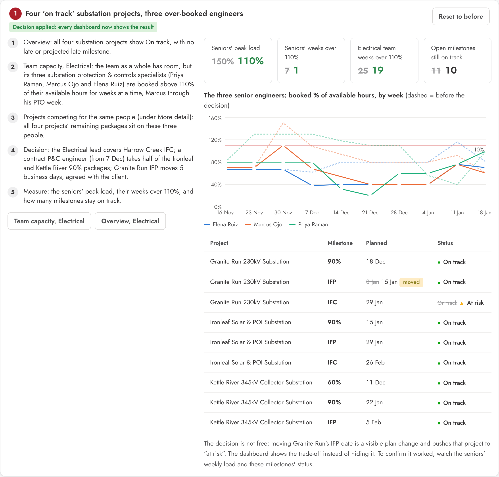

# PMO 360: a dashboard I built, and the decisions it changed

Case study for Option 1 · Supply Chain Program Manager, Data Center Sourcing & Procurement · Jayasurya

> **Live demo:** https://jayasurya23.github.io/pmo-aws/ . It opens on a Start page. Every number on the site opens the list of records behind it. The data is invented, so no client, project or person on the site is real.

## The short version

I built PMO 360 at Castillo Engineering, where we design utility-scale solar projects. Before it, project status was spread across Monday.com, Smartsheet, Outlook, spreadsheets and people's meeting notes. Priorities were set in the weekly meeting, mostly from memory.

PMO 360 brought that information together in one set of dashboards. The question it helps us answer every week is a plain one: where should our people and our follow-up go this week?

## Who used it

- **Project managers**, for their own list: what do I owe, to whom, and by when.
- **The PM lead and leadership**, for every project ranked worst first.
- **Department leads**, for a week-by-week view of who has room for the next milestone.
- **Approvers**, for the change orders waiting on them.

The lead view started out as leads-only. The project managers asked to see it too, so I opened it up to everyone. It covers about 42 to 53 portfolios across 21 to 25 clients. [add: how many people use it each week, and how many meetings and action items it tracks a month]

## The decision it changed

Before PMO 360, the weekly meeting started with people comparing notes. Now it starts from the dashboard: which projects are behind, who is overloaded, and which follow-ups nobody owns. So the decision it changed is where staffing and follow-up effort goes each week, and how early we act on it.

One example from the real system. One screen told a project manager they had 27 overdue actions. Another screen said 2. The gap came from a rule nobody had noticed: whoever typed up the meeting notes was counted as the owner of everything in them. I rewrote ownership as one rule that every screen uses, and changed the owner picker so an owner is set when the action is created. People only act on numbers they trust, so this mattered more than any new chart.

[add: one real decision, in your own words. What the dashboard showed, what you or the team did, and what happened after]

## Two decisions you can try on the demo

The demo walks through two decisions step by step. They run on invented data, so they show the kind of call the dashboards support rather than a specific event from the real system.

**1. Staffing: four projects looked fine, but three engineers were overloaded.**
On the Overview, all four solar projects read "on track". Team capacity showed a different picture. All four depended on the same three senior electrical engineers, booked at well over 110% of their hours for weeks, one of them through a week of PTO. The team as a whole had room. Those three people didn't.

The decision was to move one package to the team lead, who had room, bring in a contract engineer for half of two packages, and move one deadline by five business days with the client's agreement. Their overloaded weeks went from 9 to 1, and their peak load from 150% to 110%. The cost is visible too: the project whose date moved now shows as at risk. The dashboard shows that trade-off instead of hiding it.

**2. Schedule: one blocked package was about to delay the final drawings.**
The Schedule page showed Cedar Hollow Solar furthest behind, with its final milestone projected 28 business days late. The project page showed why. A structural package had been blocked for weeks, waiting on the client's soil report, and the follow-up action had no owner. The decision was to carry on with an agreed design assumption, add a second engineer and give the action an owner. The final milestone came back to 2 days, which is within tolerance. The milestone that was already late stays late, because the dashboard doesn't rewrite history.

## What I had to do to the data

Most of the work wasn't the charts. It was getting the data to agree.

- **Matching records across tools.** The same project had a slightly different name in every tool. I match on exact names only, ignoring case and punctuation, plus a short list of links someone has confirmed by hand. Anything else goes on a list for a person to check. A wrong match would file work against another client's project, so I'd rather flag it than guess. In the real Monday.com sync, 38 of 40 board items carried a job number.
- **One meaning for each word.** Every team wrote status its own way, so their words now map to one set. "Overdue" means the due date is before today. Work with no due date is shown, not hidden. A blank estimate is unknown, never zero.
- **Meeting notes into action items.** An AI model turns meeting notes into a draft list of actions, and a project manager checks each one before it is saved.
- **Showing the work.** Every number opens the records behind it, so anyone can check it. On the demo, automated checks confirm each headline number matches its list of records.

## Why this fits the role

Data center sourcing has the same shape of problem: tools that don't agree, definitions that drift between teams, and people who need to see early when a delivery is at risk. The approach would be the same. Sit with the people who make the calls, agree what each number means, join the sources carefully, and give them views they trust enough to act on. In our world, the Issued-for-Purchase design package is the signal procurement waits on before ordering long-lead equipment, which is exactly the kind of handoff a sourcing team cares about.

## About the demo site

The site has the two decision walkthroughs and six dashboards: Overview, Schedule, Team capacity, Action items, Proposals and Billables. A short page explains how the numbers come together. I built it end to end, and PMO 360 itself stays private along with its data.
