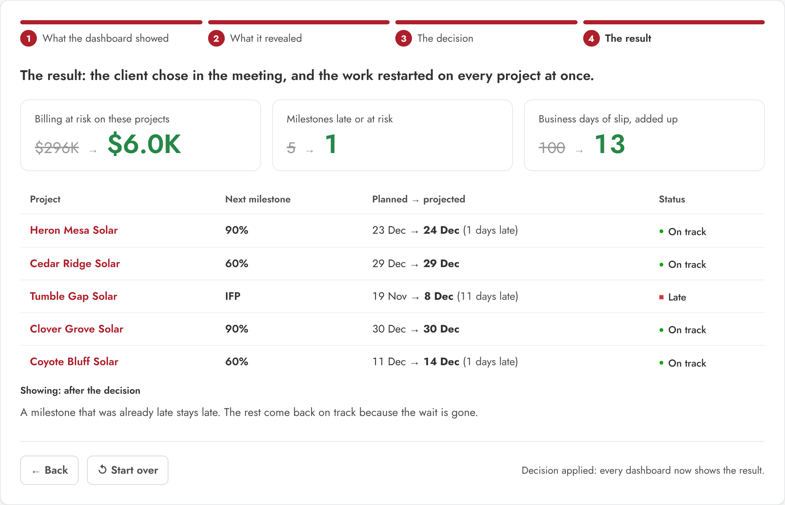

# PMO 360: a dashboard I built, and the decisions it changed

Case study for Option 1 · Supply Chain Program Manager, Data Center Sourcing & Procurement · Jayasurya

> **Live demo:** https://jayasurya23.github.io/pmo-aws/ . It opens on a Start page. Every number on the site opens the list of records behind it. The data is invented, so no client, project or person on the site is real.

## The short version

I built PMO 360 at Castillo Engineering, where we design utility-scale solar projects. Before it, project status was spread across Monday.com, Smartsheet, Outlook, spreadsheets and people's meeting notes. Priorities were set in the weekly meeting, mostly from memory.

PMO 360 brought that information together in one set of dashboards. The question it helps us answer every week is a plain one: where should our people and our follow-up go this week?

## Who used it

- **Project managers**, for their own list: what do I owe, to whom, and by when.
- **The PM lead and leadership**, for every project ranked worst first.
- **Department leads**, for a week-by-week view of who has room for the next milestone.
- **Approvers**, for the change orders waiting on them.

The lead view started out as leads-only. The project managers asked to see it too, so I opened it up to everyone. It covers about 42 to 53 portfolios across 21 to 25 clients. [add: how many people use it each week, and how many meetings and action items it tracks a month]

## The decisions it changed

Before PMO 360, the weekly meeting started with people comparing notes. Now it starts from the dashboard: which projects are behind, who is overloaded, and which follow-ups are stuck. So the decision it changed is where staffing and follow-up effort goes each week, and how early we act on it. Three times it changed a specific call.

**Overloaded engineers behind projects that looked fine.** Every project read on track, but looking person by person showed the same few engineers carrying several projects at once. Spreading that work before anything slipped became a regular conversation instead of a surprise. [add: what you saw, what you changed, and what happened after]

**One client decision holding up several projects.** We are a design firm, so most of our blockers are on the client's side: design decisions, data they owe us, and choices about which equipment to use, from our recommendations or their own. Grouping the blocked work by what it was waiting on showed one client decision holding up several projects at once. One conversation at the portfolio level replaced chasing it project by project. [add: what was being waited on, roughly how many projects, and the result]

**Bidding within capacity.** Proposals looked fine one at a time. Adding them to the work already sold, month by month, showed when winning them would overload a team, so start dates and staffing could be set before the work was awarded. [add: what you saw and what changed]

One more example from the real system, about trust. One screen told a project manager they had 27 overdue actions. Another said 2. The gap came from a rule nobody had noticed: whoever typed up the meeting notes was counted as the owner of everything in them. I rewrote ownership as one rule that every screen uses, and changed the owner picker so an owner is set when the action is created. People only act on numbers they trust, so this mattered more than any new chart.

## Try them on the demo

The demo has a step-by-step walkthrough for each of those three. Each shows what the dashboard showed, what it revealed, the decision, and the result. The names and numbers are invented.

- **Overloaded engineers:** three senior engineers carry four "on track" projects. Moving work to the team lead and a contractor, and one deadline by five days, takes their overloaded weeks from 9 to 1.
- **One client decision:** five of one client's projects wait on the same equipment choice. Settling it in one meeting cuts billing at risk on those projects from $296K to about $6K.
- **Bidding within capacity:** if the open proposals are won as dated, Civil needs 108% of its hours in January. Agreeing later starts on four proposals brings it to 99%.

## What I had to do to the data

Most of the work wasn't the charts. It was getting the data to agree.

- **Matching records across tools.** The same project had a slightly different name in every tool. I match on exact names only, ignoring case and punctuation, plus a short list of links someone has confirmed by hand. Anything else goes on a list for a person to check. A wrong match would file work against another client's project, so I'd rather flag it than guess. In the real Monday.com sync, 38 of 40 board items carried a job number.
- **One meaning for each word.** Every team wrote status its own way, so their words now map to one set. "Overdue" means the due date is before today. Work with no due date is shown, not hidden. A blank estimate is unknown, never zero.
- **Meeting notes into action items.** An AI model turns meeting notes into a draft list of actions, and a project manager checks each one before it is saved.
- **Showing the work.** Every number opens the records behind it, so anyone can check it. On the demo, automated checks confirm each headline number matches its list of records.

## Why this fits the role

Data center sourcing has the same shape of problem: tools that don't agree, definitions that drift between teams, and people who need to see early when a delivery is at risk. The approach would be the same. Sit with the people who make the calls, agree what each number means, join the sources carefully, and give them views they trust enough to act on. In our world, the Issued-for-Purchase design package is the signal procurement waits on before ordering long-lead equipment, which is exactly the kind of handoff a sourcing team cares about.

## About the demo site

The site has three decision walkthroughs and six dashboards: Overview, Schedule, Team capacity, Action items, Proposals and Billables. A short page explains how the numbers come together. I built it end to end, and PMO 360 itself stays private along with its data.
