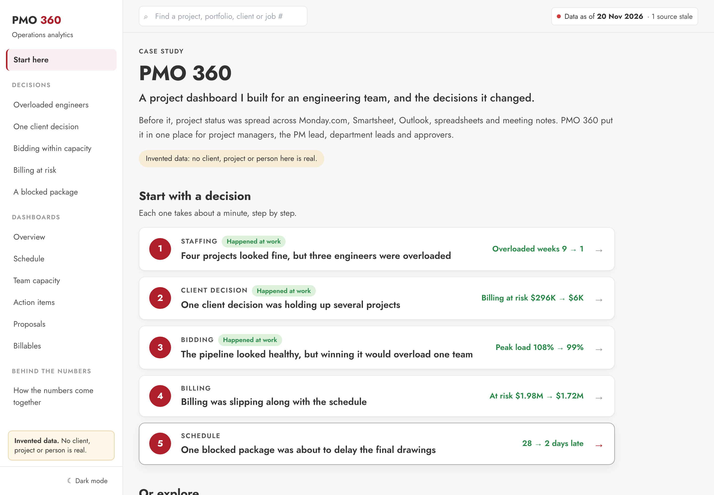

# PMO 360: a dashboard I built, and the decisions it changed

Case study, Option 1 · Supply Chain Program Manager, Data Center Sourcing & Procurement · Jayasurya

> **Live demo:** https://jayasurya23.github.io/pmo-aws/ . Start with any of the decisions on the Start page. The data is invented; no client, project or person on the site is real.

## Who used it

I built PMO 360 at Castillo Engineering, where we design utility-scale solar projects. Before it, project status was spread across Monday.com, Smartsheet, Outlook, spreadsheets and meeting notes; PMO 360 brought it together in one set of dashboards. Project managers use it for their own action list, the PM lead and leadership to see every project ranked worst first, department leads to see who has room, and approvers to see change orders waiting on them. It covers about 42 to 53 portfolios across 21 to 25 clients. The lead view started out as leads-only; the project managers asked for it, so I opened it to everyone. [add: weekly users and action items tracked a month]

## What decision it changed

Priorities used to be set in the weekly meeting from memory. Now the meeting starts from the dashboard, so the decision it changed is where staffing and follow-up effort goes each week, and how early we act. Three real examples:

- **Overloaded engineers.** Projects read on track, but person by person, the same few engineers carried several of them. We spread the work before anything slipped. [add: result]
- **One client decision holding up several projects.** As a design firm, most blockers are client decisions and data. Grouping blocked work by what it waited on showed one client decision behind several projects, settled in one portfolio-level conversation. [add: result]
- **Bidding within capacity.** Adding open proposals to sold work, month by month, showed when winning them would overload a team, so start dates were set before award. [add: result]

The demo has a step-by-step walkthrough for each, on invented data, plus two more examples (billing at risk, and a blocked package).

## What I had to do to the data

- Matched records across tools on exact names only, plus links confirmed by hand. Anything unclear is flagged for a person, never guessed.
- Gave each word one meaning: each team's status words map to one set, overdue means due before today, and a blank estimate is unknown rather than zero.
- Used an AI model to turn meeting notes into draft action items, with a project manager checking each one before it is saved.
- Made every number open the records behind it, so anyone can check it.

