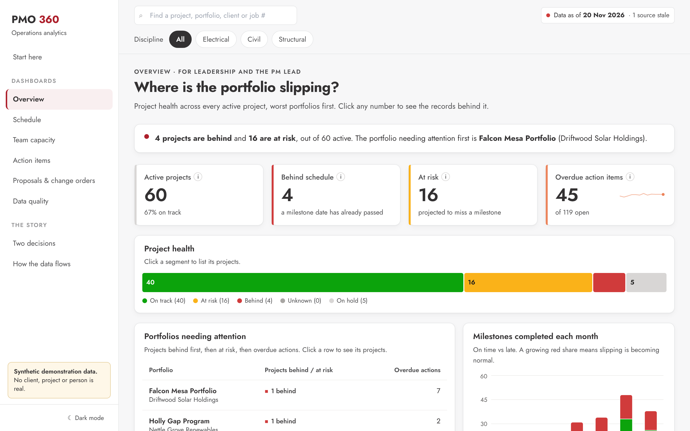
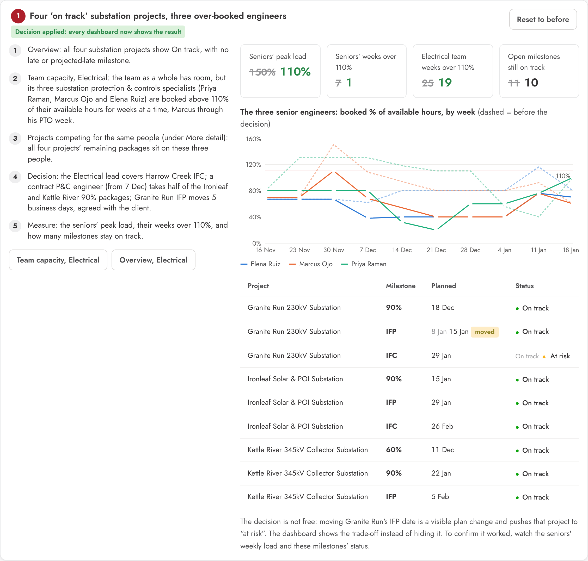
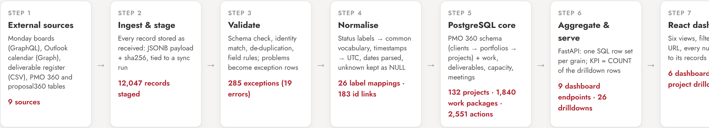

# PMO 360: an operations dashboard I built end-to-end

**Case study — Option 1** · Supply Chain Program Manager, Data Center Sourcing & Procurement (AWS) · Jayasurya

> **How to read the numbers.** Figures marked ✔ are verifiable in the PMO 360 source repository. Figures marked 🧪 come from the synthetic demonstration I rebuilt for this interview, where every client, project and person is invented. Anything in **[CONFIRM: …]** is a production figure I will supply from a read-only query (listed in the appendix) before submission; I have not estimated it.

---

## 1. Project overview

**Business context.** Castillo Engineering designs utility-scale solar, battery-storage (BESS) and substation projects. Its project managers run weekly coordination meetings with clients and EPCs across many portfolios at once, through design stages from 30% to 60% and 90%, then *Issued for Purchase* (IFP, the package clients order long-lead equipment from) and *Issued for Construction* (IFC).

**The problem.** Operational status lived in five places that did not agree. Monday.com held job numbers and tasks. Outlook held the meetings. Excel proposal workbooks held the schedules. Meeting notes held the action items. Spreadsheets held who was working on what. A weekly status picture meant opening every one of them, and nobody could answer "what is overdue across all portfolios, and who owns it?" without building it by hand.

**My role.** I am the primary software/AI engineer and built PMO 360 end to end. I gathered requirements with the PMs, designed the data model, built the backend, frontend and integrations, set up auth and deployment, and ran the iteration with users. ✔ The repository shows **223 commits and 30 merged pull requests over about six months (May–November 2026), all authored by me**. It contains 26 API routers (159 endpoints), 34 database tables evolved through 46 migrations, and about 32,000 lines of Python and 47,000 lines of TypeScript.

**Stack.** FastAPI (Python) · PostgreSQL · React + TypeScript + Tailwind · Monday.com GraphQL API · Microsoft Graph (Entra ID sign-in, Outlook calendar, Mail, SharePoint) · OpenAI for meeting-note parsing with human review · Azure Container Apps via GitHub Actions.

## 2. Who used it

| User group | What they needed to know | How they used PMO 360 |
|---|---|---|
| **Project managers** (the core users) | "What do I owe, to whom, by when — and what did the client promise us?" | Captured minutes (notes → AI parse → PM review → saved), rolled actions forward meeting to meeting, generated client-ready minutes and agendas, and worked from *My Work*: open, overdue, due this week, undated. |
| **PM lead / operations leadership** | "Which portfolios are slipping, and is any PM overloaded?" | The *Lead dashboard*: org totals, portfolio health sorted worst-first, per-PM workload, unassigned actions. ✔ It was first built for leads only; **the team asked for it to be opened to every PM, and I changed the access rule** (documented in `api/lead.py`). |
| **Department leads / resource planners** | "Who is free to take this milestone, and when?" | The *Timeline* capacity board: engineers by discipline, bookings with utilisation, time off, placeholders for new hires. Proposal schedules can be pushed onto the board as milestone chips and dragged onto engineers. It auto-refreshes so concurrent PMs see each other's edits. |
| **Proposal and commercial staff** | "What did we quote, and what scope has been added since?" | Proposals → versioned schedules synced to portfolios; change orders with an approval-request history. |
| **Approvers and admins** | "What am I being asked to approve?" | Named approval requests by email; per-module permission management. |
| **Clients** (indirect) | Accurate minutes and action logs | Received the generated PDF/Word minutes and action logs. |

✔ **Scale in production**, from snapshots recorded in the code: about **42 portfolios under ~21 clients** with **8 staff** to assign when I built the bulk staffing panel; **23 clients** and **118 client contacts** at the contacts import; a Monday Portfolio board of **40 items**; **50 production proposal workbooks**. At one documented snapshot the platform held **~25 clients, 53 portfolios and 24 sub-projects**. **[CONFIRM: active users in the last 30 days and monthly; meetings captured and actions tracked per month (queries Q2–Q3)].**

*Figure 1 — 🧪 Executive view in the demo rebuild: one rule for project health, every number drillable to its records.*

## 3. What decision did the dashboard change?

**Before:** prioritisation happened in the weekly meeting itself, from memory. An action that slipped was noticed when someone remembered to ask. Staffing a new milestone meant asking around.

**After:** PMO 360 is built so the weekly cycle starts from the data. The lead view ranks portfolios worst-first, so follow-up effort goes to the two or three portfolios with the most overdue items, not the loudest ones. Each PM's *My Work* shows exactly what is theirs. Staffing is decided on the Timeline board with every engineer's existing load visible before a milestone is committed. The decision it changes is **where the team spends its follow-up and staffing effort each week, and how early it acts**. **[CONFIRM: that the lead and PMs review the Lead / My Work views before or in the weekly coordination meetings, and that staffing is agreed on the Timeline board.]**

**[CONFIRM: one specific production instance, e.g. "In <month>, the lead view showed <n> overdue actions concentrated on <a portfolio/client type>; we <re-assigned / escalated / moved a milestone>, and within <n> weeks overdue fell to <n>."]** Queries Q5 and Q6 produce the before/after numbers for any instance you choose.

**A decision that is fully verifiable in the repository** changed what the dashboard itself reports. Early on, any action the minute-taker had saved counted as "theirs". On real data, a PM who owned nothing saw **30 open / 30 overdue**, and the *My Work* panel said **27 overdue where the briefing said 2** ✔. I rewrote ownership as one explicit rule shared by every screen: a linked user id first, then a name match, then authorship only as a last resort. I also fixed the owner picker, which had been silently failing (it asked a 200-user endpoint for 500 users), so new actions carry a real user id. A number nobody trusts changes no decisions. Making it right was the precondition for everything above.

**Demonstrated decision workflow (synthetic).** The demo shows the capacity decision end to end. Four high-voltage substation projects all read *On track* on the schedule view. The capacity view shows their design packages all sit on three senior engineers, each booked above 110% of their available hours for weeks, one with work booked through his PTO. The decision is to put the substation lead on one IFC package, bring in a contract engineer for half of two 90% packages, and re-sequence one IFP by five days with the client. 🧪 That takes their over-allocated person-weeks **from 8 to 1** (peak load 150% → 110%), with one visible trade-off: the re-sequenced project's IFC moves to *at risk*.

*Figure 2 — 🧪 The capacity decision applied in the demo: before (dashed) vs after, and the milestone trade-off it creates.*

## 4. What I had to do to the underlying data

**Sources and fragmentation.** Monday.com boards (job numbers; tasks in other teams' boards), Outlook calendars, Excel proposal workbooks, free-text meeting notes, and PMO 360's own records. No shared identifier existed: Monday names projects one way, proposals another, and the job number lived "only in Monday and in people's heads" ✔.

**Extraction.**
* *Monday.com* — a read-only GraphQL sync. It refuses any mutation, resolves columns **by title** (column ids change when a column is recreated), pages with cursors, and unwraps `display_value` for relation and mirror columns. It runs as a dry run by default.
* *Microsoft Graph* — delegated calendar reads. Each event is matched to a portfolio by a manual link first, then a **client** attendee email (internal colleagues are never indexed, because they attend everything), then the subject.
* *Meeting notes* — an LLM turns raw notes into structured discussion points and action items; **a PM reviews every item before it is saved**.

**Identifier mapping.** The job number is stored as an **opaque string**: never parsed, indexed but **not unique**, because one Monday item can legitimately cover two portfolios. A uniqueness violation on a free-text value would have been a container boot loop, not a failed write. Matching is **exact after normalisation only** (case, punctuation and spacing removed). Ambiguous, orphan, unnumbered and sub-project-only cases go to a report for a person; nothing is auto-created, because one Monday item can map to two portfolios and three items to one. ✔ 38 of the 40 board items carried a job number.

**Data model (PostgreSQL).** Client → Portfolio → Project, with meetings, rolling action items (originating and closing meeting), deliverables, schedules, Timeline resources and bookings, proposals and change orders. Invariants live in the database: a unique constraint on portfolio membership (a duplicate row "lies about how staffed a portfolio is"), one active proposal per project, optimistic-concurrency version columns, and an append-only approval history.

**Data quality and KPI definitions.**
* **Overdue = open and due strictly before today.** Due today is not late. "Due this week" starts today so it never double-counts. Undated work is reported, never hidden or counted as late.
* **Blank is unknown, never zero.** A missing estimate shows as unavailable on every total.
* **One definition, shared by every screen**, so the same action cannot be overdue on one page and not another.

**Aggregation, API and UI.** Each dashboard endpoint runs a fixed handful of bulk queries regardless of data volume (the *My Work* endpoint is eight). Metrics are computed server-side at a declared grain and rendered in React with drill-through to the records.

*Figure 3 — 🧪 The pipeline in the demo rebuild: source → stage → validate → normalise → PostgreSQL → API → React.*

**What the demo adds to show the full discipline** (demo-only): every source record staged as received with a hash, 24 validation rules with an exception log that drills to the raw payload, freshness SLAs per source, a deliberately broken register export that the pipeline refuses whole instead of loading blanks, and **84 automated tests** proving that each KPI equals its drilldown and an independent SQL count.

## 5. Challenges and trade-offs

* **Inconsistent data.** Owners were free text for most of the app's life. I resolved them by rule and fixed the entry point rather than cleaning the output.
* **Changing requirements.** The "Project" tier under portfolios arrived mid-build. I scoped it to proposals first, with an additive migration and no backfill, so existing data behaved exactly as before.
* **Schema evolution.** 46 additive migrations applied automatically at start-up. Nullable-first, never-unique free text, and defaults treated as decisions: change-order permissions are **off** by default because approval emails reach people who have never opened the app.
* **Integration constraints.** Monday's many-to-many naming and regenerated column ids; Graph's delegated permissions and admin consent.
* **Reliability.** ✔ A download bug (browser links missing the auth token) went unnoticed in production for six days. I replaced every such link with one authenticated download path and wrote the rule down in the code. The lesson is that endpoint health is not user health.
* **Stakeholder feedback, built in.** The lead view was opened to all PMs. Staffing 8 people across ~42 portfolios took **336 dropdown interactions** ✔; I replaced it with one grouped, staged bulk panel.

## 6. Results and business impact

| Category | Result |
|---|---|
| ✔ **Verified (repository)** | One platform replacing scattered status checks for ~42–53 portfolios; 223 commits / 30 PRs in ~6 months by me; ownership-rule fix that removed a 27-vs-2 overdue discrepancy; Monday job-number backfill with exception reporting (38/40 numbered); lead view opened to all PMs on request; 336-step staffing task replaced by one panel. |
| **Qualitative** | Weekly coordination starts from one shared view; client minutes and agendas generated from the same records; change-order approvals carry history. |
| 🧪 **Synthetic demo examples** | Capacity decision: over-allocated person-weeks 8 → 1. Blocked-package decision: IFC projection moves from 27 business days late back inside tolerance. All on invented data. |
| **[CONFIRM]** | Active users per month (Q2); meetings captured and actions tracked (Q3); overdue share of open actions over time (Q5); median days to close an action (Q6); share of actions with a linked owner before/after the picker fix (Q7); change-order decision time (Q9). I have not estimated any of these. |

## 7. Lessons learned

1. **Define metrics before charts.** Every disagreement between two screens was a definition problem. Write the rule once, with its grain, and share it.
2. **Fix data at entry, not in the dashboard.** The owner picker did more for data quality than any clean-up query.
3. **Show freshness and exceptions next to the numbers.** People trust a dashboard that admits what it doesn't know.
4. **Adoption follows usefulness to the person doing the work.** PMs adopted the tool that wrote their minutes. The dashboard came with it.
5. **What I'd do differently:** instrument usage from day one (I have to reconstruct adoption from timestamps), add monitoring on user-facing paths, and build the staging and exception layer the demo shows into production.

**Relevance to DCSP.** The job is the same shape as this role's: partner with the people making the decisions (PMs ↔ category and supply-chain managers), integrate internal tools that disagree (Monday, Outlook and Excel ↔ sourcing and planning systems), standardise definitions across programmes, and build self-service reporting that people trust enough to act on. The IFP milestone is literally the engineering signal long-lead equipment procurement waits on.

---
*Appendix — read-only production queries:* `tools/production_metrics.sql` (Q1–Q11) in the demo repository, validated against PMO 360's real schema; aggregates only, no records leave the database. *Demo:* React + FastAPI + PostgreSQL rebuild on synthetic data; see `README.md`.
